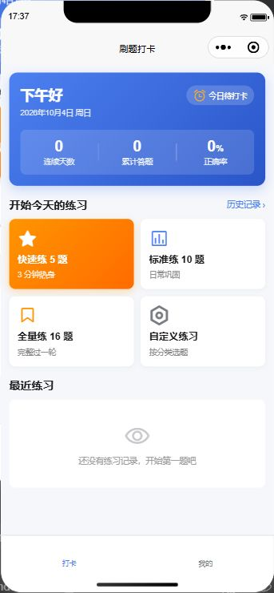
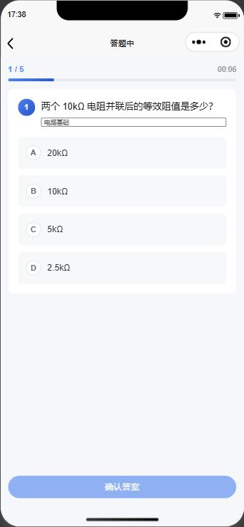
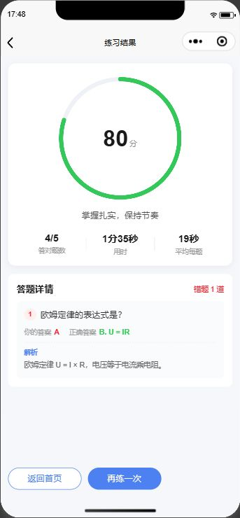
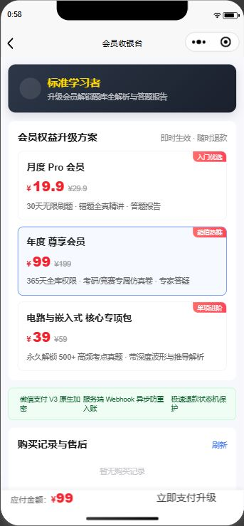
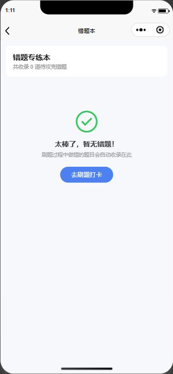
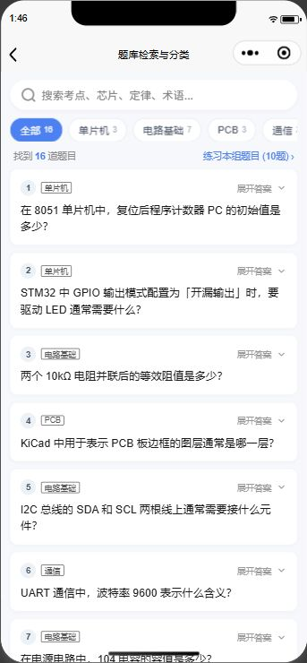

# ⚡ uni-miniprogram-pro

> **现代化跨端微信小程序全栈开发与商业实战脚手架**  
> 基于 **Vite 5 + Vue 3 (Composition API) + TypeScript + Pinia + Wot Design Uni** 构建，集成微信云开发（CloudBase）双轨仿真、自建 API 双 Token 静默无感刷新、微信支付 V3 全时序/退款状态机、断路器异常熔断及原生社交裂变闭环。

---

[](LICENSE)
[](https://vuejs.org)
[](https://vitejs.dev)
[](https://www.typescriptlang.org)
[](https://uniapp.dcloud.net.cn)
[](https://wot-design-uni.netlify.app)
[](https://mp.weixin.qq.com)

---

## 📱 真实模拟器实测效果走查

本项目所有交互与页面均经由**微信开发者工具官方 DevTools MCP 自动化引擎**完成真实渲染与回归走查验证：

| 1. 首页打卡看板 | 2. 交互式全真答题 | 3. 练习报告与雷达 |
| :---: | :---: | :---: |
|  |  |  |
| **4. 微信支付 V3 收银台** | **5. 错题专练本 (Wrong Book)** | **6. 题库分类多维检索** |
|  |  |  |

---

## 🚀 30 秒快速上手 (Quick Start)

### 1. 克隆与安装依赖

```bash
git clone https://github.com/mo9652962-ai/uni-miniprogram-pro.git
cd uni-miniprogram-pro
npm install --registry=https://registry.npmmirror.com
```

### 2. 启动微信小程序热重载

```bash
npm run dev:mp-weixin
```

产物将实时编译并监听更新至 `dist/dev/mp-weixin/`。

### 3. 打开微信开发者工具调试

1. 启动【微信开发者工具】，点击【导入项目】；
2. **项目目录**选择：`uni-miniprogram-pro/dist/dev/mp-weixin`；
3. **AppID**：填写个人测试号或正式小程序 AppID（`src/manifest.json` 已配置）；
4. 进入设置勾选：`不校验合法域名、web-view（业务域名）、TLS版本以及HTTPS证书`，即可开始全功能调试！

---

## 🌟 核心技术演进与架构矩阵

本项目摒弃过时的原生 WXML/WXSS 语法死磕路线，遵循模块化、可复用、高韧性的现代化工程理念：

| 维度 | 阶段 1：入门跑通 | 阶段 2：云开发全栈闭环 | 阶段 3：商业实战与裂变 |
| :--- | :--- | :--- | :--- |
| **前端驱动** | Vite 5 + Vue 3 组合式 API + TS | 页面生命周期与下拉刷新/触底分页 | 通用骨架屏 `<SkeletonLoader>` 防白屏 |
| **组件规范** | Wot Design Uni `easycom` 自动按需引入 | 卡片化题目交互与倒计时计时器 | 商业化会员收银台界面、商品矩阵卡片 |
| **存储与状态** | Pinia + `uni.setStorageSync` 离线持久化 | 用户档案初始化与打卡流水写入 | 双 Token 本地安全存储、VIP 权益响应式状态 |
| **后端能力** | 本地静态题库与算法打卡统计 | 3 大 JSON Document 集合 + 4 大云函数 | 自建 API + 微信云开发双轨自动降级引擎 |
| **鉴权体系** | 匿名访客静默试用 | 服务端信任根提取 `wxContext.OPENID` | 双 Token（AccessToken + RefreshToken）无感刷新队列 |
| **商业闭环** | — | — | 微信支付 V3 统一下单、RSA 签名包、订单状态机与退款 |
| **可靠性防御** | 基础 try-catch 兜底 | 云端故障时自动无缝切换本地云仿真 | 三态断路器（Circuit Breaker）防雪崩降级保护 |
| **业务拓展** | 快速练/标准练/深度冲刺 | 题库异步分页拉取与云端同步 | 错题本去重攻克、题库多维检索、微信朋友圈裂变分享 |

---

## 🏗️ 核心架构与时序设计

### 1. 自建 API 双 Token 无感静默刷新队列

避免 AccessToken 过期导致多并发请求竞态击穿与死锁，采用 **`isRefreshing` 互斥锁 + `refreshSubscribers` 队列重放** 模式：

```
客户端 (uni.request)             应用拦截器 (request.ts)             服务端 API
       │                                │                                │
       │─── 1. 并发发起 3 个请求 ───────▶│                                │
       │    (携带过期 AccessToken)       │─── 2. 转发请求 ───────────────▶│
       │                                │◀── 3. 返回 401 Unauthorized ───│
       │                                │                                │
       │                                │ ─── 4. 加锁 isRefreshing = true
       │                                │ ─── 5. 其余 2 个请求挂起进队列
       │                                │                                │
       │                                │─── 6. POST /auth/refresh-token ▶│
       │                                │◀── 7. 派发新 Token ────────────│
       │                                │                                │
       │                                │ ─── 8. 更新持久化 Token
       │                                │ ─── 9. 队列中请求自动补挂新 Token 重放
       │◀── 10. 用户无感获取全部数据 ─────│◀── 11. 批量返回 200 OK ───────│
```

---

### 2. 微信支付 V3 业务时序与安全入账红线

```
[商户前端]                 [商户服务端]               [微信官方支付系统]
    │                          │                            │
    │── 1. 提交商品订单 ───────▶│                            │
    │   (POST /order/create)   │── 2. 调用统一下单 JSAPI ───▶│
    │                          │◀── 3. 返回 prepay_id ───────│
    │                          │ (商户私钥 RSA-SHA256 计算签名)
    │◀── 4. 下发支付参数包 ────│                            │
    │    (timeStamp, paySign)  │                            │
    │                          │                            │
    │── 5. uni.requestPayment ─┼───────────────────────────▶│
    │◀── 6. 用户指纹/密码支付成功 ──────────────────────────│
    │                          │                            │
    │  [⚠️ 安全红线：前端回调绝非发货凭据]                     │
    │                          │◀── 7. Webhook 异步通知 ────│
    │                          │    (验签入账更新 PAID)      │
    │── 8. apiPollOrderStatus ─▶│                            │
    │◀── 9. 服务端确认 PAID ───│ (权益激活并交付)           │
```

**订单状态机流转：**  
`PENDING (待支付)` $\xrightarrow{\text{支付成功}}$ `PAID (已支付/激活)` $\xrightarrow{\text{申请退款}}$ `REFUNDING (退款中)` $\xrightarrow{\text{微信回调}}$ `REFUNDED (已退款/权益收回)`

---

### 3. 生产级三态断路器 (Circuit Breaker)

为保护微信小程序弱网或后端故障时免受雪崩冲击，在 `src/utils/circuitBreaker.ts` 内置三态断路器：

```
      连续失败达到 4 次阈值
       ┌────────────────────────┐
       ▼                        │
 ┌──────────┐ 冷却期满 (12s) ┌──────────┐ 试探请求失败 ┌──────────┐
 │  CLOSED  │───────────────▶│   OPEN   │────────────▶│HALF_OPEN │
 │ (正常放行)│                │(阻断降级)│             │ (试探放行)│
 └──────────┘                └──────────┘             └──────────┘
       ▲                                                    │
       └──────────────── 连续试探成功 2 次 ──────────────────┘
```

---

## 📂 项目文件目录一览

```
uni-miniprogram-pro/
├── cloudfunctions/                     # 微信云开发官方服务端云函数
│   ├── login/                          # 服务端 OPENID 提取与自愈注册
│   ├── getQuestions/                   # 题库拉取：聚合 sample 抽样 + skip/limit 分页
│   ├── syncPractice/                   # 答题提交：db.command.inc 原子递增 + 连签计算
│   ├── getUserStats/                   # 个人看板数据汇总
│   ├── questions_seed.json             # 16 道题目初始化种子文档
│   └── README.md                       # 云数据库 Schema 设计与安全规则
├── src/
│   ├── components/
│   │   ├── common/SkeletonLoader.vue   # 通用高精度骨架屏组件 (card/profile/list)
│   │   └── quiz/QuestionCard.vue       # 交互式题卡组件
│   ├── config/env.ts                   # 多环境与白名单配置
│   ├── data/questions.ts               # 内置嵌入式与电路考点真题库
│   ├── pages/
│   │   ├── index/index.vue             # 首页打卡看板、连续天数、快捷练习入口、社交分享
│   │   └── my/index.vue                # 个人中心、数据统计、会员中心与功能导航
│   ├── services/
│   │   ├── cloud.ts                    # 微信云开发 SDK 与本地云仿真降级引擎
│   │   ├── pay.ts                      # 微信支付 V3 全时序、商品矩阵与退款状态机
│   │   └── quizApi.ts                  # 题库与做题业务网关
│   ├── store/
│   │   ├── checkin.ts                  # 打卡、连续天数、错题本 (wrongIds) 持久化
│   │   └── user.ts                     # 用户信息、双 Token 存储、VIP 会员状态
│   ├── subpackages/                    # 2MB 限制分包目录
│   │   ├── order/pay/index.vue         # 会员收银台分包页面
│   │   ├── quiz/history/index.vue      # 练习记录分包 (下拉刷新 + onReachBottom 触底分页)
│   │   ├── quiz/practice/index.vue     # 全真答题进行页与倒计时
│   │   ├── quiz/result/index.vue       # 练习报告战报与社交分享
│   │   ├── quiz/search/index.vue       # 题库多维分类检索与考点展开
│   │   ├── quiz/setup/index.vue        # 自定义练习设置
│   │   ├── quiz/wrong/index.vue        # 错题专练本与空状态
│   │   └── tools/calculator/index.vue  # 辅助小工具分包
│   ├── utils/
│   │   ├── circuitBreaker.ts           # 生产级三态断路器
│   │   └── request.ts                  # 自建 API 双 Token 静默刷新拦截请求层
│   ├── App.vue                         # 小程序全局应用入口与更新检测
│   ├── main.ts                         # Pinia 注册与 Vue 根实例初始化
│   ├── manifest.json                   # uni-app 跨端配置文件
│   └── pages.json                      # 路由导航、TabBar、分包规则与 easycom
├── docs/                               # 架构演进报告与真机模拟器截图
└── scripts/                            # 自动化逻辑单元测试集
```

---

## 🧪 自动化测试与工程验证

项目全套逻辑具备自动化单元测试脚本与类型门禁，拒绝伪成果：

```bash
# 1. 运行阶段 1 核心打卡与连续天数算法验证 (10/10 PASS)
node scripts/verify-stage1-logic.mjs

# 2. 运行阶段 2 微信云开发规范与链路验证 (5/5 PASS)
node scripts/verify-stage2-cloudbase.mjs

# 3. 运行阶段 3 商业实战（双Token刷新+微信支付+断路器）验证 (5/5 PASS)
node scripts/verify-stage3-commercial.mjs

# 4. 运行错题本去重与掌握链路验证 (3/3 PASS)
node scripts/verify-wrong-book.mjs

# 5. 运行题库分类检索与社交分享链路验证 (3/3 PASS)
node scripts/verify-search-and-share.mjs

# 6. 全局 TypeScript 静态类型检查 (0 错误)
npx vue-tsc --noEmit -p tsconfig.json

# 7. 小程序生产环境编译构建
npm run build:mp-weixin
```

---

## 📄 开源许可证

本项目基于 [MIT 许可证](LICENSE) 开源发布，欢迎自由修改、学习与商业化派生。
